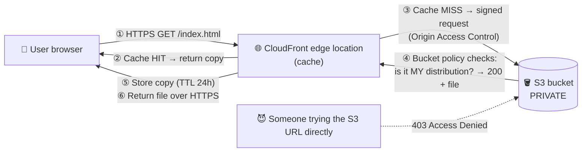
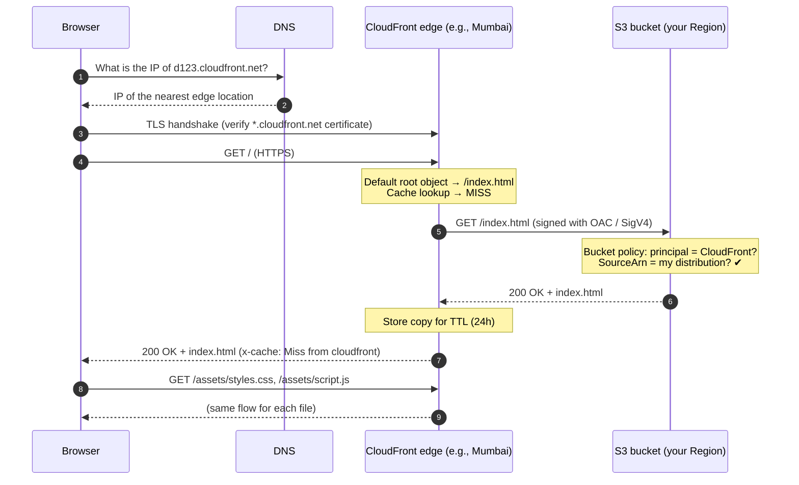

# Project 1: Host a Static Website with Amazon S3 + Amazon CloudFront

> **Who does what?**
> - ✅ **Done by your mentor (Claude):** wrote the website files in [`website/`](website/), wrote this guide and an optional deploy script, and checked the steps against current AWS docs (Nov 2026).
> - 🧑‍💻 **Done by you:** every step inside the AWS Console. I have **no access** to your AWS account and I have **not deployed anything**. Your website goes live only when you complete the steps below.

**Prerequisite:** finish [Step 0: Account, Security & Cost setup](../00-getting-started/ACCOUNT-SECURITY-AND-COST.md) first (MFA, IAM user, Budgets).

**Time:** ~1.5–2 hours, plus ~5–15 minutes waiting for CloudFront to deploy.
**Expected cost:** **$0.00**. A ~20 KB website is far below the S3 and CloudFront free limits (details in [Cost](#cost-what-will-this-cost)).

---

## Table of contents

1. [Understand the objective](#step-1-understand-the-objective)
2. [Understand the architecture + key terms](#step-2-understand-the-architecture)
3. [Prepare the environment](#step-3-prepare-the-environment)
4. [Build it, step by step](#step-4-build-it)
5. [Explain the implementation](#step-5-explain-the-implementation)
6. [Testing](#step-6-testing)
7. [Real-world use in companies](#step-7-how-companies-use-s3--cloudfront-in-production)
8. [Troubleshooting](#step-8-troubleshooting)
9. [Interview preparation](#step-9-interview-questions)
10. [Project completion + cleanup](#step-10-project-completion)
11. [Your assessment](#your-assessment)

---

## Step 1: Understand the objective

### What we are building
A small, professional personal website ("My AWS Cloud Journey") that:
- is stored as plain files (HTML, CSS, JavaScript) in **Amazon S3**,
- is delivered worldwide, fast, over **HTTPS**, by **Amazon CloudFront**,
- keeps the S3 bucket **private**: visitors can only reach the files *through* CloudFront.

At the end you'll have a public URL like `https://d1a2b3c4d5e6f7.cloudfront.net` that anyone in the world can open.

### What problem does this solve?
The traditional way to host a website is to rent a server, install web-server software, patch it, monitor it, and pay for it 24/7 even when nobody visits. For a **static** website that's overkill. With S3 + CloudFront:
- **No servers to manage**: no operating system, no patches, no crashes at 3 a.m.
- **Very cheap**: you pay per GB stored/transferred; small sites cost cents or nothing.
- **Fast everywhere**: copies are cached in hundreds of locations worldwide.
- **Scales automatically**: 10 visitors or 10 million, same setup.
- **Secure by default**: HTTPS, private storage, built-in DDoS protection (AWS Shield Standard).

### What is a static website?
A **static website** is made of files that are sent to the browser **exactly as they are stored**. The server doesn't run any code to build the page; it just hands over files.

| Static website | Dynamic website |
|---|---|
| Files: `.html`, `.css`, `.js`, images, fonts | Pages are generated per request by server code (Java/Spring Boot, Python, Node.js, PHP) |
| Same file for every visitor | Content can differ per user (e.g. "Hello, Kiran", your cart, your bank balance) |
| No database on the server | Usually talks to a database |
| Examples: portfolio, documentation, landing page, a React/Angular app *after* `npm run build` | Examples: Amazon.com checkout, Gmail, a banking portal |

*Analogy:* a static site is a **printed brochure**: every reader gets the same copy. A dynamic site is a **bank teller**: they look up your account and give you a personal answer.

> 💡 JavaScript **can** make a static site interactive (our "Say hello" button), because the JS runs **in the visitor's browser**, not on AWS. S3 never executes your code; it only stores and returns files.

---

## Step 2: Understand the architecture

### The big picture

```
                              HTTPS (encrypted)                     signed request (OAC / SigV4)
  ┌──────────────┐   ①  ───────────────────────►   ┌─────────────────────┐   ③  ─────────────►  ┌──────────────────────┐
  │ User Browser │                                 │  Amazon CloudFront   │                       │   Amazon S3 bucket    │
  │ (anywhere in │   ⑥  ◄───────────────────────   │  (nearest edge       │   ④  ◄─────────────   │   (PRIVATE)           │
  │  the world)  │      HTML/CSS/JS + padlock 🔒   │   location, cache)   │      file + 200 OK     │  index.html, error.html│
  └──────────────┘                                 └─────────────────────┘                       │  assets/styles.css    │
                                                     ② cache HIT? → answer                        │  assets/script.js     │
                                                        immediately (skip ③④)                     └──────────────────────┘
                                                     ⑤ cache MISS → store a copy                    ▲ Bucket policy allows ONLY
                                                        for next visitors                           │ this CloudFront distribution
                                                                                                    │ ✖ Direct public access BLOCKED
```

Same flow as a Mermaid diagram (GitHub renders it automatically):



### What each arrow means

| # | Arrow | What happens | Why it matters |
|---|---|---|---|
| ① | Browser → CloudFront | Your browser looks up `dxxxx.cloudfront.net` via DNS, gets the IP of the **nearest edge location**, opens an encrypted **HTTPS** connection and asks for `/index.html`. | Short distance = low latency. HTTPS = nobody in between can read or alter the page. |
| ② | CloudFront → Browser (HIT) | If that edge already has a fresh copy (a **cache hit**), it answers immediately. S3 is never contacted. | Fastest path; cheaper; protects S3 from traffic spikes. |
| ③ | CloudFront → S3 (MISS) | If no fresh copy (a **cache miss**), CloudFront requests the file from the **origin** (our S3 bucket). The request is **signed** using **Origin Access Control (OAC)** so S3 can verify who is asking. | The bucket stays private but CloudFront can still read it. |
| ④ | S3 → CloudFront | S3 checks its **bucket policy**: "Is this request from the CloudFront service *and* from distribution `E123…` in *my* account?" If yes → returns the file. | Least privilege: only one specific distribution may read, and only read (`s3:GetObject`). |
| ⑤ | CloudFront caches | The edge stores the file for the **TTL** (time to live, 24 hours by default with the recommended settings). | Next visitors near this edge get a cache hit. |
| ⑥ | CloudFront → Browser | The file arrives over HTTPS; the browser renders HTML, then requests `assets/styles.css` and `assets/script.js` the same way. | One page = several requests (HTML, CSS, JS, images). |
| ✖ | Direct S3 URL | Anyone who tries `https://<bucket>.s3.<region>.amazonaws.com/index.html` gets **403 Access Denied**. | Proves the bucket is private. |

### The key terms (read these before building)

#### Amazon S3 (Simple Storage Service)
- **What:** AWS's **object storage** service. You store files of any type and size (up to 5 TB each) and read them over HTTPS.
- **Analogy:** an **infinitely large, extremely reliable storage warehouse for files**. You rent shelf space by the gigabyte.
- **Problem it solves:** you never worry about disks filling up, hardware failing or backups of the hardware. S3 is designed for **99.999999999% (11 nines) durability**: it stores copies of your data across multiple Availability Zones.
- **Where companies use it:** website files, images and videos, user uploads (profile photos, documents), application logs, database backups, data lakes for analytics, ML training data.
- **Relation to other services:** CloudFront reads from it; EC2 and Lambda read/write it; IAM controls who can access it.

#### S3 bucket
- **What:** a **top-level container** for objects. Every object lives in exactly one bucket.
- **Analogy:** **one warehouse** with your company name on the door.
- **Rules worth knowing:**
  - The name must be **globally unique across all AWS accounts in the world** (in the same partition), 3–63 characters, lowercase letters, numbers, hyphens. E.g. `kiran-cloud-journey-site-2026`.
  - A bucket is created in **one Region** (your files physically live there).
  - Since April 2023, new buckets are **private by default**: **Block Public Access** is ON and ACLs are disabled. That's what we want.

#### Objects and "folders" in S3
- **Object** = a file + its **metadata** (size, `Content-Type`, last-modified date, etc.) + its **key**.
- **Key** = the object's full name, e.g. `assets/styles.css`.
- **Folders are an illusion!** S3 has a **flat** structure. There are no real directories. The console *displays* `assets/` as a folder because the key contains a `/`. *Analogy:* a warehouse where every box has a long label like `assets/styles.css`; the console groups boxes by the text before `/` to make it look tidy.
- **Content-Type metadata** tells the browser what the file is (`text/html`, `text/css`, `application/javascript`). The console sets it automatically from the file extension. If it's wrong, the browser may download a page instead of displaying it.

#### Public bucket vs private bucket
| | Public bucket (old way) | Private bucket + CloudFront OAC (modern way, what we do) |
|---|---|---|
| Who can read? | **Anyone on the internet**, directly from S3 | **Only** your CloudFront distribution |
| HTTPS? | S3 *website endpoint* supports **HTTP only** | HTTPS via CloudFront |
| Speed | Served from one Region | Served from the nearest edge location worldwide |
| Risk | Easy to accidentally expose other files; many real data leaks happened this way | Bucket is never exposed |
| Requires | Turning **off** Block Public Access + public bucket policy | Block Public Access stays **on** |

> 🔒 **Security rule:** never make a bucket public unless you fully understand why. Many real-world data breaches came from misconfigured public S3 buckets.

#### Amazon CloudFront and CDNs
- **CDN (Content Delivery Network):** a worldwide network of servers that keep **copies (caches)** of your content close to users.
- **Analogy:** instead of every customer travelling to your one central warehouse (S3 in one Region), you place stock in **local delivery centers in hundreds of cities**. Customers pick up from the nearest one.
- **Amazon CloudFront** is AWS's CDN: **600+ edge locations (Points of Presence)** in 100+ cities.
- **Key CloudFront vocabulary:**
  - **Distribution:** your CloudFront configuration. It gets a domain like `d1a2b3c4d5e6f7.cloudfront.net`.
  - **Origin:** where the original files live (our S3 bucket). It can also be an EC2 server, a load balancer or any web server.
  - **Edge location:** a data center where CloudFront caches content and talks to users.
  - **Cache behavior:** rules for a URL path (which origin, HTTP→HTTPS redirect, how long to cache, allowed methods).
  - **TTL (Time To Live):** how long a cached copy is considered fresh.
  - **Cache hit / miss:** the edge had a copy / had to fetch from origin.
  - **Invalidation:** telling CloudFront "throw away your cached copies of these paths" so it fetches fresh ones.
  - **Default root object:** which file to return when someone requests `/` (we set `index.html`).

#### How does CloudFront retrieve content from S3? → Origin Access Control (OAC)
- **Problem:** the bucket is private. How can CloudFront read it, while the public cannot?
- **Solution, OAC:** CloudFront **signs** every request it sends to S3 (using AWS **Signature Version 4**, the same signing method every AWS API call uses). S3's **bucket policy** then allows `s3:GetObject` **only** when:
  1. the caller is the **CloudFront service** (`cloudfront.amazonaws.com`), **and**
  2. the request comes from **your specific distribution** (condition `AWS:SourceArn` = your distribution's ARN).
- **Analogy:** the warehouse (S3) only releases goods to delivery trucks that show a **company-stamped, tamper-proof order slip** (the signature) **and** come from **your** delivery company's fleet (the source ARN check). Random people at the gate are turned away.
- **OAC vs OAI:** **OAI (Origin Access Identity)** is the *older, legacy* method. AWS recommends **OAC** for all new setups (it supports more Regions, SSE-KMS encryption and more HTTP methods). If a tutorial says OAI, it's outdated.
- **ARN (Amazon Resource Name):** a globally unique ID for any AWS resource, e.g. `arn:aws:cloudfront::123456789012:distribution/E2ABCDEF12345`.

#### HTTPS and why it matters
- **HTTP** (HyperText Transfer Protocol) is the language browsers and web servers use to request and send pages. Plain HTTP is **unencrypted**: anyone on the network path (public Wi-Fi, an ISP) can read or modify it.
- **HTTPS** = HTTP inside an encrypted **TLS** (Transport Layer Security) connection. It gives you:
  1. **Encryption**: nobody in between can read the data.
  2. **Integrity**: nobody can secretly modify it (e.g. inject ads or malware).
  3. **Authentication**: a **TLS certificate** proves you're really talking to `xxx.cloudfront.net`, not an impostor.
- **Analogy:** HTTP is a **postcard** anyone can read. HTTPS is a **sealed, tamper-evident envelope with a verified sender ID**.
- Browsers mark HTTP sites "Not secure", Google ranks HTTPS higher, and many browser features (geolocation, service workers) require HTTPS.
- **CloudFront gives you HTTPS for free** on the `*.cloudfront.net` domain. For your own domain (`www.example.com`) you'd get a free certificate from **AWS Certificate Manager (ACM)**, covered in Step 7.

#### IAM in this project
You already met IAM in Step 0. In this project IAM concepts show up in two places:
1. **You** act as your IAM admin user in the console (identity-based policy `AdministratorAccess`).
2. **The bucket policy** is a **resource-based policy**: a policy attached to the *resource* (bucket) instead of to a user. It names *who* (the CloudFront service principal) may do *what* (`s3:GetObject`) on *which* resource (`arn:aws:s3:::your-bucket/*`) under *which condition* (only your distribution).

---

## Step 3: Prepare the environment

### Checklist
- [ ] Step 0 completed (Free plan, MFA, IAM user, Budgets).
- [ ] You're signed in as your **IAM user**, not root.
- [ ] Your **Region** is selected (top-right of the console) and written down.
- [ ] You have the website files on your laptop.

### Get the website files onto your Windows laptop
Open **PowerShell** or **Git Bash**:

```powershell
# 1. Choose a working folder (change the path if you like)
cd $HOME\Documents

# 2. Clone your GitHub repository (replace with your repo URL if different)
git clone https://github.com/saarav354/aws.git
cd aws

# 3. Switch to the branch that contains these projects
git checkout claude/aws-three-projects-cqwsvl

# 4. Look at the website files
dir .\project-1-s3-cloudfront\website -Recurse
```

**Expected output (abbreviated):**
```
    Directory: ...\project-1-s3-cloudfront\website
d----   assets
-a---   error.html
-a---   index.html

    Directory: ...\project-1-s3-cloudfront\website\assets
-a---   script.js
-a---   styles.css
```

### Preview the site locally first (good habit)
Double-click `website\index.html`. It opens in your browser from your disk (`file:///...`). You should see the dark-blue header, the hero section with **"Site version: v1.0"**, three project cards, and a working **"Say hello 👋"** button.

> If it looks right locally, any later problem is an AWS configuration problem, not a code problem. This is how professionals isolate bugs.

### Understand the files (open them in VS Code: `code .`)
| File | Purpose |
|---|---|
| `index.html` | The home page: structure and content |
| `error.html` | Custom "page not found" page CloudFront will show for missing URLs |
| `assets/styles.css` | All styling: colors, layout, dark mode, mobile-friendly grid |
| `assets/script.js` | Runs in the visitor's browser: footer year, load time, the hello button |

### Cost: what will this cost?
| Service | What we use | Price (pay-as-you-go, approx.) | Our cost |
|---|---|---|---|
| S3 storage | ~20 KB | ~$0.023 per GB-month (S3 Standard, us-east-1; varies by Region) | ≈ $0.0000005/month → **$0** |
| S3 requests | A few hundred GETs from CloudFront | ~$0.0004 per 1,000 GET | **$0** |
| CloudFront | A few MB transfer, a few thousand requests | **Always free:** 1 TB transfer + 10 M requests per month | **$0** |
| CloudFront invalidations | A handful | First **1,000 paths/month free**, then $0.005/path | **$0** |
| OAC, bucket policy, IAM | n/a | Free | **$0** |
| AWS WAF (firewall) | ❌ **We do NOT enable it** | Pay-as-you-go WAF costs ≈ $5+/month per web ACL | $0 (skipped) |

On the **Free plan**, any small cost is deducted from your credits, never billed to your card. Verify with the [AWS Pricing Calculator](https://calculator.aws/) if you like.

> ⚠️ **Cost traps to avoid in this project:** enabling **WAF**, choosing a **paid CloudFront flat-rate plan** (Pro/Business/Premium), enabling **real-time logs**, or uploading large videos. We avoid all of them.

---

## Step 4: Build it

Each step lists: **What · Why · Where to click · What to select · Expected result · How to verify · Common errors.**

### 4.1 Tour the AWS Management Console (2 minutes)
- **Search bar** (top, or press `Alt+S`): type a service name (S3, CloudFront, IAM…). This is the fastest way to navigate.
- **Region selector** (top-right): shows your Region. S3 lists buckets from all Regions; CloudFront says **Global** because it's a global service.
- **Account menu** (top-right): your IAM user name and account ID, plus links to Billing.
- **CloudShell icon** (`>_` near the top): a free browser terminal. We'll ignore it for now.
- **Star (☆) next to a service**: pins it to the top bar. Pin **S3**, **CloudFront**, **Billing and Cost Management**.

### 4.2 Create the S3 bucket
**What:** create the private "warehouse" for the website files.
**Why:** CloudFront needs an origin to fetch files from.

**Where to click:** search bar → **S3** → **Create bucket**.

**What to select:**
| Setting | Value | Why |
|---|---|---|
| Bucket type (if shown) | **General purpose** | Standard bucket type for websites. ("Directory" buckets are for a special high-performance class.) |
| Bucket name | e.g. `yourname-cloud-journey-site-2026` | Must be globally unique, lowercase, no spaces/underscores. |
| AWS Region (if shown) | Your chosen Region | Keep everything in one Region. |
| Object Ownership | **ACLs disabled (recommended)** | Permissions are controlled only by policies, which is simpler and safer. |
| Block Public Access settings | ✅ **Block *all* public access** (leave ON) | The bucket stays private; CloudFront will use OAC. |
| Bucket Versioning | **Disable** (default) | Keeps it simple for now. (Companies often enable it for rollback; see Step 7.) |
| Default encryption | **SSE-S3** (default) | Files are encrypted at rest with S3-managed keys, free. |
| Everything else | Defaults | |

Click **Create bucket**.

**Expected result:** green banner *"Successfully created bucket 'yourname-cloud-journey-site-2026'"*. The bucket appears in the **General purpose buckets** list.

**Verify:** open the bucket → **Permissions** tab → *Block public access (bucket settings)* shows **On**.

**Common errors**
| Error | Cause | Fix |
|---|---|---|
| *"Bucket with the same name already exists"* | Someone in the world already uses that name | Add something unique: your name, a date, random digits. |
| *"Bucket name must not contain uppercase characters"* / invalid name | Uppercase, underscores, spaces, dots at the ends | Use only `a-z`, `0-9`, `-`. |

### 4.3 Upload the website files
**What:** put the files into the bucket **with the correct folder structure**.
**Why:** CloudFront serves exactly what's in the bucket. `index.html` refers to `assets/styles.css`, so that key must exist.

**Where to click:** open your bucket → **Objects** tab → **Upload**.

1. **Add files** → select `index.html` and `error.html` from `project-1-s3-cloudfront\website\`.
2. **Add folder** → select the `assets` folder (this keeps the `assets/` prefix in the keys).
   *(Or drag and drop `index.html`, `error.html` and the `assets` folder into the drop area.)*
3. Review the list. You should see **4 files**: `index.html`, `error.html`, `assets/styles.css`, `assets/script.js`.
4. Leave **Permissions** and **Properties** at defaults → **Upload**.

> ⚠️ Upload the **contents** of the `website` folder, not the `website` folder itself. Otherwise your keys become `website/index.html` and the site URL would need `/website/index.html`.

**Expected result:** *"Upload succeeded"* with 4 files, 0 failed.

**Verify:**
- Bucket **Objects** tab shows `assets/`, `error.html`, `index.html`.
- Click `index.html` → **Properties**: **Type** = `html`; metadata **Content-Type** = `text/html`.
- On that same page, copy the **Object URL** (like `https://yourname-....s3.<region>.amazonaws.com/index.html`) and open it in a new browser tab. You should get an **`AccessDenied`** XML error. **That's correct!** The bucket is private. Save this URL for testing later.

### 4.4 Create the CloudFront distribution (with OAC)
**What:** create the CDN in front of the bucket, with a private, signed connection (OAC) to S3.
**Why:** this gives us HTTPS, global caching, and a way to keep the bucket private.

**Where to click:** search bar → **CloudFront** → **Create distribution**.

AWS's current console uses a step-by-step wizard. Follow it like this (labels may differ slightly over time):

| Wizard step | What to choose | Why |
|---|---|---|
| **Choose a plan** *(only if the wizard shows it)* | **Free ($0/month)** flat-rate plan **if it's offered to your account**, otherwise **Pay as you go**. ❌ Never Pro/Business/Premium. | Both cost $0 at our tiny traffic. (Accounts on the Free plan may not be able to pick flat-rate plans; pay-as-you-go is then used and its free limits apply.) |
| **Distribution name** | `cloud-journey-site` | A label (stored as a `Name` tag). |
| **Distribution type** | **Single website or app** | We have one website. |
| **Custom domain** *(if shown)* | Skip / leave empty | We use the free `*.cloudfront.net` domain. |
| **Origin type** | **Amazon S3** | Our files are in S3. |
| **S3 origin** | **Browse S3** → select your bucket | Use the bucket's **REST endpoint** (`bucket.s3.region.amazonaws.com`), **not** an `s3-website` endpoint. OAC only works with the REST endpoint. |
| **Settings** | **Use recommended origin settings** (if instead you see a checkbox **"Allow private S3 bucket access to CloudFront – Recommended"**, tick it) | This **creates the OAC automatically** and uses recommended cache settings (caching policy *CachingOptimized*, HTTP→HTTPS redirect). |
| **Web Application Firewall (WAF)** | **Do not enable security protections** | WAF costs money on pay-as-you-go; not needed for learning. |
| Review | **Create distribution** | CloudFront creates the distribution **and updates your S3 bucket policy for you**. |

**Expected result:** your distribution page opens. **Last modified** says **Deploying**. Note:
- **Distribution domain name**, e.g. `d1a2b3c4d5e6f7.cloudfront.net` → **copy it**.
- **Distribution ID**, e.g. `E2ABCDEF12345` → copy it.
- **ARN**, e.g. `arn:aws:cloudfront::123456789012:distribution/E2ABCDEF12345`.

Deployment to all edge locations takes about **5–15 minutes**. While waiting, do 4.5–4.7.

### 4.5 Verify the bucket policy that CloudFront created
**What:** look at the resource-based policy on the bucket.
**Why:** this policy is **the** security gate. You must be able to read and explain it in interviews.

**Where:** S3 → your bucket → **Permissions** → **Bucket policy**.

You should see something like this (your bucket name, account ID and distribution ID will differ):

```json
{
  "Version": "2012-10-17",
  "Statement": [
    {
      "Sid": "AllowCloudFrontServicePrincipalReadOnly",
      "Effect": "Allow",
      "Principal": {
        "Service": "cloudfront.amazonaws.com"
      },
      "Action": "s3:GetObject",
      "Resource": "arn:aws:s3:::yourname-cloud-journey-site-2026/*",
      "Condition": {
        "StringEquals": {
          "AWS:SourceArn": "arn:aws:cloudfront::123456789012:distribution/E2ABCDEF12345"
        }
      }
    }
  ]
}
```

**Line by line:**
| Line | Meaning |
|---|---|
| `"Version": "2012-10-17"` | The policy *language* version (not a date you change). Always use this. |
| `"Effect": "Allow"` | This statement grants permission. (By default everything is **denied**.) |
| `"Principal": {"Service": "cloudfront.amazonaws.com"}` | **Who:** the CloudFront service. |
| `"Action": "s3:GetObject"` | **What:** only *read* an object. Not list, not upload, not delete. **Least privilege.** |
| `"Resource": "arn:aws:s3:::bucket/*"` | **On what:** every object (`/*`) in this bucket. |
| `"Condition": {"StringEquals": {"AWS:SourceArn": "...distribution/E2ABC..."}}` | **Only if:** the request comes from *your* distribution. Without this, *any* CloudFront distribution in any AWS account could read your bucket! |

**If the policy is empty** (older console flows didn't auto-update it): CloudFront → your distribution → **Origins** tab → select the origin → **Edit** → under *Origin access control*, there's a **Copy policy** button. Paste it in S3 → Permissions → Bucket policy → **Edit** → **Save changes**.

### 4.6 Check the default root object and HTTPS redirect
**What:** make sure `https://dxxx.cloudfront.net/` (with nothing after the `/`) returns `index.html`, and that HTTP is redirected to HTTPS.

1. CloudFront → your distribution → **General** tab → **Settings** → **Edit**.
   - **Default root object:** `index.html` (type it if empty) → **Save changes**.
2. **Behaviors** tab → select the `Default (*)` behavior → **Edit**:
   - **Viewer protocol policy:** **Redirect HTTP to HTTPS** (should already be set).
   - **Allowed HTTP methods:** **GET, HEAD** (a static site only needs reads).
   - **Cache policy:** **CachingOptimized** (recommended for S3).
   - Save if you changed anything.

> Why default root object? When the browser asks for `/`, CloudFront would otherwise ask S3 for an object with an empty key, which doesn't exist → error.

### 4.7 Add a custom error page
**What:** show `error.html` instead of an ugly XML error for missing pages.
**Why:** with OAC and **no** `s3:ListBucket` permission, S3 returns **403 Forbidden** (not 404) for a missing file. It won't even reveal whether the file exists, which is a security feature. We translate that into a friendly 404 page.

CloudFront → distribution → **Error pages** tab → **Create custom error response**:
| Setting | Value |
|---|---|
| HTTP error code | **403: Forbidden** |
| Error caching minimum TTL | `10` (default) |
| Customize error response | **Yes** |
| Response page path | `/error.html` |
| HTTP Response code | **404: Not Found** |

Click **Create custom error response**. *(Optionally repeat for **404**, same settings.)*

> 💡 For single-page apps (React/Angular) companies instead map 403/404 → `/index.html` with **200**, so the front-end router handles the URL.

### 4.8 Open your live website 🎉
Wait until the distribution's **Last modified** shows a date/time (no longer "Deploying").

Open in your browser:
```
https://<your-distribution-domain>.cloudfront.net
```

**Expected result:**
- The website loads with styling (CSS) and a working **Say hello** button (JS).
- The browser shows a **padlock 🔒**. Click it → *Connection is secure* → certificate issued for `*.cloudfront.net`.
- `https://<your-domain>.cloudfront.net/does-not-exist` shows your **custom error page**.

**If you see an error, jump to [Step 8: Troubleshooting](#step-8-troubleshooting).**

### 4.9 Make a change and redeploy (practise the real workflow)
**What:** change the site, upload the new version, and make CloudFront serve it.

1. In VS Code, open `project-1-s3-cloudfront/website/index.html`.
2. Change:
   ```html
   <p class="version-badge">Site version: <span id="site-version">v1.0</span></p>
   ```
   to
   ```html
   <p class="version-badge">Site version: <span id="site-version">v1.1 – my first redeploy!</span></p>
   ```
3. Save. Preview locally (double-click the file).
4. S3 → your bucket → **Upload** → add the new `index.html` → **Upload** (it **overwrites** the object with the same key).
5. Refresh your CloudFront URL. **You will probably still see v1.0!** 🤔

**Why?** The edge location cached `index.html` for up to **24 hours** (the TTL). CloudFront doesn't know the file changed in S3. That's not a bug; it's caching doing its job.

### 4.10 Invalidate the CloudFront cache
**What:** an **invalidation** tells every edge location to discard cached copies of the paths you list, so the next request fetches the fresh file from S3.

CloudFront → your distribution → **Invalidations** tab → **Create invalidation**:
- **Add object paths:** `/index.html`
  *(or `/*` to invalidate everything; `/*` counts as **one** path for pricing)*
- **Create invalidation**.

**Expected result:** status **In progress** → **Completed** (usually under a minute or two). Refresh the site (`Ctrl+F5` to bypass your *browser's* cache too) → you see **v1.1**. 🎉

**Invalidation tips:**
- First **1,000 invalidation paths per month are free**; after that $0.005 per path.
- Invalidate only what changed when you can; `/*` is fine for small sites.
- **Production best practice:** don't rely on invalidations for CSS/JS. Use **versioned file names** (e.g. `styles.3f9a2c.css`, which React/Angular/Vite builds generate automatically) with a long cache TTL, and only invalidate `index.html` (or give it a short TTL). A new file name = a new cache key = no stale content.

### 4.11 Commit your change to Git (good habit)
```powershell
git add project-1-s3-cloudfront/website/index.html
git commit -m "Update site version to v1.1"
git push
```

### 4.12 (Optional) Deploy from the terminal with the AWS CLI
Clicking "Upload" is fine for learning. Real teams deploy with **commands or pipelines**. If you want to try:

1. Install **AWS CLI v2** for Windows: <https://docs.aws.amazon.com/cli/latest/userguide/getting-started-install.html>
2. Sign the CLI in **without creating long-lived access keys**:
   ```powershell
   aws --version          # expect aws-cli/2.x
   aws login              # opens your browser; sign in with your IAM user (+MFA)
   aws sts get-caller-identity   # shows your account ID and user ARN = you're signed in
   ```
   *`aws login` needs **AWS CLI 2.32.0 or later** ([docs](https://docs.aws.amazon.com/cli/latest/userguide/cli-configure-sign-in.html)). It gives the CLI **short-lived credentials that rotate automatically**, so you never create long-term access keys. Your IAM user needs the `SignInLocalDevelopmentAccess` permission (already included in `AdministratorAccess`). Run `aws logout` when done.*
3. Run the deploy script from the repo root:
   ```powershell
   .\project-1-s3-cloudfront\scripts\deploy.ps1 -BucketName "yourname-cloud-journey-site-2026" -DistributionId "E2ABCDEF12345"
   ```
   It runs `aws s3 sync` (uploads only changed files and deletes removed ones) and then `aws cloudfront create-invalidation --paths "/*"`. Read the script first: [`scripts/deploy.ps1`](scripts/deploy.ps1).

> If PowerShell blocks the script ("running scripts is disabled"), run `Set-ExecutionPolicy -Scope CurrentUser RemoteSigned` once, or run the two `aws` commands inside it by hand.

---

## Step 5: Explain the implementation

### What we actually built

| Component | Configuration | Role |
|---|---|---|
| S3 bucket | Private, Block Public Access ON, ACLs disabled, SSE-S3 encryption | Origin: the single source of truth for files |
| Objects | `index.html`, `error.html`, `assets/styles.css`, `assets/script.js` with correct `Content-Type` | The website |
| Bucket policy | Allow `s3:GetObject` for `cloudfront.amazonaws.com` only when `AWS:SourceArn` = our distribution | Resource-based, least-privilege access |
| OAC | Signing behavior: sign requests (SigV4) to the S3 origin | Lets CloudFront authenticate to S3 |
| CloudFront distribution | Default root object `index.html`, Redirect HTTP→HTTPS, GET/HEAD, CachingOptimized, custom error 403→`/error.html` (404) | CDN + TLS + caching + security edge |
| HTTPS certificate | Default `*.cloudfront.net` certificate | Encryption in transit |

### Full request flow: first visitor near Mumbai (cache miss)


**Second visitor near the same edge:** steps 6–8 are skipped. The edge answers immediately with `x-cache: Hit from cloudfront`.

### Deployment flow (how a change reaches users)
```
 Edit in VS Code ──► git commit/push (history) ──► Upload to S3 (console or `aws s3 sync`)
        ──► CloudFront invalidation (/index.html or /*) ──► next request = cache MISS ──► fresh file cached at edges
```

### Why each design decision
- **Private bucket + OAC instead of public bucket:** smaller attack surface, HTTPS, and CloudFront becomes the single front door where you can later add WAF, logging and geo-restrictions.
- **REST endpoint instead of S3 website endpoint:** OAC only works with the REST endpoint; the website endpoint is HTTP-only and requires a public bucket.
- **Redirect HTTP→HTTPS:** nobody accidentally uses the insecure version.
- **Only GET/HEAD:** nothing can be written through CloudFront.
- **Custom error response:** friendly UX + doesn't leak S3 XML errors.

---

## Step 6: Testing

Do these in **PowerShell** (replace the placeholders).

```powershell
$CF  = "https://d1a2b3c4d5e6f7.cloudfront.net"
$S3  = "https://yourname-cloud-journey-site-2026.s3.ap-south-1.amazonaws.com"   # your bucket's object URL base
```

| # | Test | Command | Expected result | What it proves |
|---|---|---|---|---|
| 1 | Home page works | `curl.exe -I $CF/` | `HTTP/1.1 200 OK` (or `HTTP/2 200`), `content-type: text/html` | Default root object + OAC + bucket policy work |
| 2 | Caching works | Run test 1 **twice**; look at `x-cache` | 1st: `x-cache: Miss from cloudfront`, 2nd: `x-cache: Hit from cloudfront` | Edge caching |
| 3 | Which edge served you | Look at `x-amz-cf-pop` header | e.g. `BOM78-P1` (Mumbai), `IAD89-C1` (Virginia) | You're served by a nearby PoP |
| 4 | HTTPS redirect | `curl.exe -I http://d1a2b3c4d5e6f7.cloudfront.net/` | `301 Moved Permanently` + `location: https://...` | Viewer protocol policy |
| 5 | Bucket is private | `curl.exe -I $S3/index.html` | `403 Forbidden` | No direct public access |
| 6 | CSS & JS delivered | `curl.exe -I $CF/assets/styles.css` and `.../assets/script.js` | `200`, `content-type: text/css` / `application/javascript` (or `text/javascript`) | Folder keys + content types |
| 7 | Custom error page | `curl.exe -i $CF/nope.html` | `404` + HTML of your error page | Custom error response |
| 8 | Visual + JS | Open `$CF` in a browser, click **Say hello** | Styled page, padlock, message appears | Full end-to-end |
| 9 | Redeploy | Change version → upload → invalidate → `Ctrl+F5` | New version visible | Your deployment workflow |

Example of a good result for test 1:
```
HTTP/1.1 200 OK
Content-Type: text/html
Content-Length: 4012
Connection: keep-alive
Last-Modified: Sat, 14 Nov 2026 10:21:07 GMT
Server: AmazonS3
X-Cache: Miss from cloudfront
Via: 1.1 1a2b3c....cloudfront.net (CloudFront)
X-Amz-Cf-Pop: BOM78-P1
```

> PowerShell-native alternative: `(Invoke-WebRequest -Uri "$CF/" -Method Head).Headers`

**Also check in the browser:** press `F12` → **Network** tab → reload. Click `index.html` → **Headers** → find `x-cache`, `x-amz-cf-pop`, `via`.

---

## Step 7: How companies use S3 + CloudFront in production

1. **Hosting front-end apps.** React, Angular and Vue apps are built (`npm run build`) into static files, uploaded to S3 and served by CloudFront. A Spring Boot backend (Project 2/3 territory) serves the API separately.
2. **Static assets for dynamic sites.** Even dynamic sites put images, CSS, JS, fonts and videos on S3 + CloudFront so their application servers only handle the dynamic work.
3. **Custom domain + free certificate.** **Route 53** (AWS's DNS service) points `www.company.com` to the distribution; **ACM** issues a free TLS certificate. *For CloudFront, the ACM certificate must be in `us-east-1`.*
4. **CI/CD deployments.** A **GitHub Actions** pipeline builds the site, runs `aws s3 sync`, then invalidates `index.html`. It authenticates with an **IAM role via OpenID Connect (OIDC)**, so **no long-lived access keys are stored in GitHub**.
5. **Infrastructure as Code (IaC).** The bucket, OAC, policy and distribution are defined in **CloudFormation, AWS CDK or Terraform** files and reviewed like code, not clicked by hand.
6. **Caching strategy.** Hashed asset names with a long TTL (e.g. 1 year) + a short TTL or invalidation for `index.html`.
7. **Security layers.** **AWS WAF** rules (block bots, SQL-injection patterns, rate-limit), **AWS Shield** (DDoS protection; Standard is free and automatic), security headers via a **response headers policy** (HSTS, CSP), geo-restriction, **signed URLs/cookies** for paid content (e.g. course videos).
8. **Reliability.** **S3 Versioning** for instant rollback, **origin failover** (a second bucket in another Region via an origin group), separate buckets/distributions for **dev / staging / prod**.
9. **Observability.** CloudFront standard logs, CloudWatch metrics (requests, 4xx/5xx error rate, cache hit ratio), alarms when the error rate spikes.
10. **Cost.** Flat-rate CloudFront plans or committed pricing for big traffic; S3 lifecycle rules to move old files to cheaper storage classes.

Real-world example: a streaming or e-commerce company stores millions of product images or video segments in S3 and serves them via CloudFront to millions of users, while S3 itself only sees a tiny fraction of the requests thanks to the cache.

---

## Step 8: Troubleshooting

**How to debug independently (the method):**
1. **Reproduce** with `curl.exe -I <url>` and read the **status code** and **headers**.
2. **Isolate the layer:** does the file open locally? Is it in S3 with the right key? Does the request even reach S3 (`x-cache: Error from cloudfront`)?
3. **Check the config** of that layer (policy, origin, behavior, error pages).
4. **Change one thing at a time**, then invalidate and re-test.

| Symptom | Likely cause | How to fix |
|---|---|---|
| **403 AccessDenied (XML)** at the CloudFront URL `/` | **Default root object** not set | Distribution → General → Edit → Default root object = `index.html` |
| **403 AccessDenied** for every file | Bucket policy missing/wrong, or the origin has no OAC | Check 4.5: policy principal `cloudfront.amazonaws.com`, correct bucket ARN with `/*`, `AWS:SourceArn` = **this** distribution's ARN. Check Origins → Edit → OAC selected. |
| **403** for one specific file | Wrong key (typo, upper/lower case, uploaded inside `website/` folder) | S3 keys are **case-sensitive**. Compare the key in S3 with the path in your HTML. |
| **504 / "Distribution not found"** right after creation | Still deploying, or DNS not propagated | Wait until **Last modified** shows a date; retry after 5–15 min. |
| Page loads but **no styling** | `styles.css` not at key `assets/styles.css`, or wrong path in HTML | Check S3 keys; `F12` → Network shows the 403/404 for the CSS file. |
| Browser **downloads** the HTML instead of showing it | Wrong `Content-Type` metadata (common when uploading via scripts) | S3 → object → Properties → Metadata → edit `Content-Type` to `text/html`; re-upload; invalidate. |
| Old content after upload | CloudFront cache (TTL) and/or browser cache | Create invalidation; then `Ctrl+F5` or open a private window. |
| S3 object URL **works publicly** | Block Public Access was turned off + a public policy exists | Turn **Block all public access** back ON; remove `"Principal": "*"` statements. |
| Origin domain looks like `bucket.s3-website-...` | You selected the **website endpoint** | Edit origin → choose the bucket's REST endpoint `bucket.s3.<region>.amazonaws.com`; set OAC. |
| `AccessDenied` + KMS mentioned | Bucket uses **SSE-KMS** with a customer key | Use SSE-S3 for this project, or add the CloudFront principal to the KMS key policy. |
| Custom error page itself shows 403 | `error.html` missing or the path lacks a leading `/` | Upload `error.html` at the root; path must be `/error.html`. |

---

## Step 9: Interview questions

### Basic
1. **What is Amazon S3?** Object storage service: store files (objects) in buckets, accessed over HTTPS APIs, 11 nines durability, pay per GB and per request.
2. **What is a bucket, an object and a key?** Bucket = container (globally unique name, one Region). Object = file + metadata. Key = the object's full name/path, e.g. `assets/styles.css`.
3. **Does S3 have folders?** No, S3 has a flat namespace. "Folders" are just key prefixes that the console displays like folders.
4. **What is a static website?** A site whose files are delivered as-is (HTML/CSS/JS/images) with no server-side code generating pages.
5. **What is a CDN / CloudFront?** A globally distributed cache network; CloudFront serves content from edge locations close to users for lower latency, offloads the origin, adds HTTPS and security.
6. **What is an origin?** The source of truth CloudFront fetches from on a cache miss (S3, ALB, EC2, any HTTP server).

### Intermediate
7. **Why put CloudFront in front of S3 instead of making the bucket public?** HTTPS, lower latency, caching (fewer S3 requests), private bucket via OAC, single entry point for WAF/logging/headers, built-in DDoS protection.
8. **What is OAC and how does it work?** CloudFront signs origin requests with SigV4; the bucket policy allows `s3:GetObject` only for the `cloudfront.amazonaws.com` service principal with an `AWS:SourceArn` condition matching the distribution. OAC replaced the legacy OAI.
9. **Why the `AWS:SourceArn` condition?** Without it, any CloudFront distribution in any account could read your bucket (the confused-deputy problem).
10. **What's a TTL and what is a cache hit ratio?** TTL = how long a cached object is fresh. Hit ratio = % of requests served from cache; higher = faster and cheaper.
11. **You uploaded a new file but users see the old one. Why, and what are two fixes?** Edge caches still hold it. Fixes: create an invalidation, or use versioned/hashed file names (preferred for assets).
12. **Why does a missing file return 403 instead of 404 with OAC?** CloudFront lacks `s3:ListBucket`, so S3 won't reveal whether the key exists and returns 403. Map it with a custom error response.
13. **Identity-based vs resource-based policy?** Identity-based is attached to a user/group/role ("what can *I* do?"). Resource-based is attached to a resource like a bucket ("who can access *me*?") and includes a `Principal`.

### Advanced
14. **How would you add a custom domain with HTTPS?** Request an ACM certificate in **us-east-1** (DNS validation), add the domain as an alternate domain name (CNAME) on the distribution with that certificate, create a Route 53 alias A/AAAA record pointing to the distribution.
15. **How would you host a React SPA with client-side routing?** Same setup + custom error responses mapping 403/404 → `/index.html` with 200 (or a CloudFront Function to rewrite URLs), long TTL for hashed assets, short TTL/invalidation for `index.html`.
16. **How would you design CI/CD for this securely?** GitHub Actions → assume an IAM role via OIDC (no stored keys) → `npm run build` → `aws s3 sync --delete` → invalidate `/index.html`. Separate dev/stage/prod. Infrastructure in Terraform/CDK.
17. **How do you protect against a sudden traffic spike or attack?** Caching absorbs load, Shield Standard for L3/L4 DDoS, WAF rate-based rules, CloudWatch alarms on 4xx/5xx and request count, Budgets alerts.
18. **How would you roll back a bad deployment?** Enable S3 Versioning (restore previous versions) or deploy to versioned prefixes and switch the origin path; then invalidate.

---

## Step 10: Project completion

### What you learned
- Cloud computing, AWS, Regions, the Console
- S3: buckets, objects, keys, prefixes ("folders"), metadata/Content-Type, Block Public Access, encryption at rest
- CloudFront: distributions, origins, edge locations, behaviors, TTL, cache hit/miss, default root object, custom error responses, invalidations
- Security: private buckets, OAC, SigV4 signing, resource-based bucket policies, least privilege, HTTPS/TLS
- Operations: deploy → cache → invalidate workflow; testing with `curl.exe` and browser DevTools; debugging by layer

### Services used
Amazon S3 · Amazon CloudFront · AWS IAM (users, MFA, bucket policy) · AWS Budgets / Billing

### Important commands
```powershell
curl.exe -I https://<dist>.cloudfront.net/                 # status + headers
curl.exe -i https://<dist>.cloudfront.net/missing.html     # body + headers
# Optional AWS CLI:
aws login
aws sts get-caller-identity
aws s3 ls s3://<bucket>/ --recursive
aws s3 sync .\project-1-s3-cloudfront\website s3://<bucket> --delete
aws cloudfront create-invalidation --distribution-id <ID> --paths "/*"
```

### Skills gained (resume-ready)
- *Deployed a static website on AWS using Amazon S3 and Amazon CloudFront with Origin Access Control, keeping the S3 bucket fully private and enforcing HTTPS.*
- *Wrote and validated a least-privilege S3 bucket policy restricting reads to a single CloudFront distribution via an `AWS:SourceArn` condition.*
- *Configured CDN caching, custom error responses and cache invalidation; verified edge caching behavior with HTTP header analysis (`x-cache`, `x-amz-cf-pop`).*

### 🧹 Cleanup checklist (do this when you're finished with Project 1)
> You may keep the site running while you do Projects 2 and 3 (it costs ~$0). But **before your Free plan ends**, or if you want a clean account, delete it in this order:

1. [ ] **CloudFront → your distribution → Disable.** Wait until **Last modified** shows a date (~5–15 min).
   *(If you subscribed the distribution to a flat-rate plan, cancel/remove the plan first when the console asks.)*
2. [ ] **CloudFront → select the disabled distribution → Delete.**
3. [ ] **CloudFront → Security → Origin access → select the OAC → Delete** (allowed once no distribution uses it).
4. [ ] **S3 → select your bucket → Empty** → type `permanently delete` → confirm.
5. [ ] **S3 → select the bucket → Delete** → type the bucket name → confirm.
6. [ ] **Billing and Cost Management → Bills / Cost Explorer**: confirm no unexpected charges. Keep your **Budgets**. They're free and protect you during Projects 2 and 3.

---

## Your assessment

Answer these in the chat. I'll evaluate, correct misunderstandings and explain why. Short answers in your own words are perfect.

### 5 basic questions
1. In your own words, what's the difference between a **static** and a **dynamic** website? Give one example of each.
2. What is the difference between an S3 **bucket**, an **object**, and a **key**? Does S3 really have folders?
3. What does **CloudFront** do that S3 alone does not? Name at least three things.
4. What is **Origin Access Control (OAC)**, and what would happen if you deleted the bucket policy?
5. Why do we use **HTTPS**? What three protections does it give?

### 3 practical tasks
1. Add a new page `projects.html` (copy `index.html`, change the content), link to it from the nav, upload it, and open it via CloudFront. Did you need an invalidation for the *new* file? Why or why not?
2. Change a color in `styles.css` (e.g. `--brand`), upload it, and make the change visible using an invalidation of **only that one path**. Tell me the exact path you invalidated.
3. Run `curl.exe -I` twice against your site and paste the `x-cache` and `x-amz-cf-pop` headers from both runs. Explain what they mean. *(Don't paste anything secret. These headers are safe to share.)*

### 3 troubleshooting scenarios
1. Your colleague opens `https://dxxx.cloudfront.net/` and gets an XML **AccessDenied**, but `https://dxxx.cloudfront.net/index.html` works perfectly. What's wrong and how do you fix it?
2. After creating the distribution, **every** URL returns AccessDenied, including `/index.html`. The S3 bucket policy is empty. What happened and how do you fix it?
3. A teammate "fixed" an error by turning off **Block Public Access** and adding a policy with `"Principal": "*"`. The site works. Why is this a problem, and what's the correct fix?

### Explain the architecture in your own words
Describe, step by step, what happens from the moment you type your CloudFront URL into the browser until the page appears, for **both** a cache miss and a cache hit. Mention: DNS, edge location, HTTPS, OAC, bucket policy, TTL.

---

➡️ **Next:** once you've deployed and sent me your answers, we go straight to **Project 2: Deploy a Web Server on Amazon EC2**.
